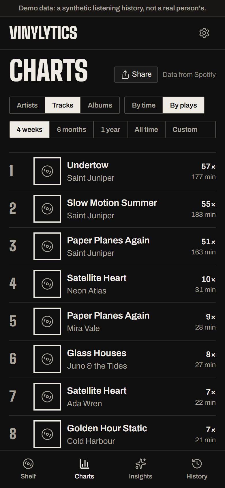
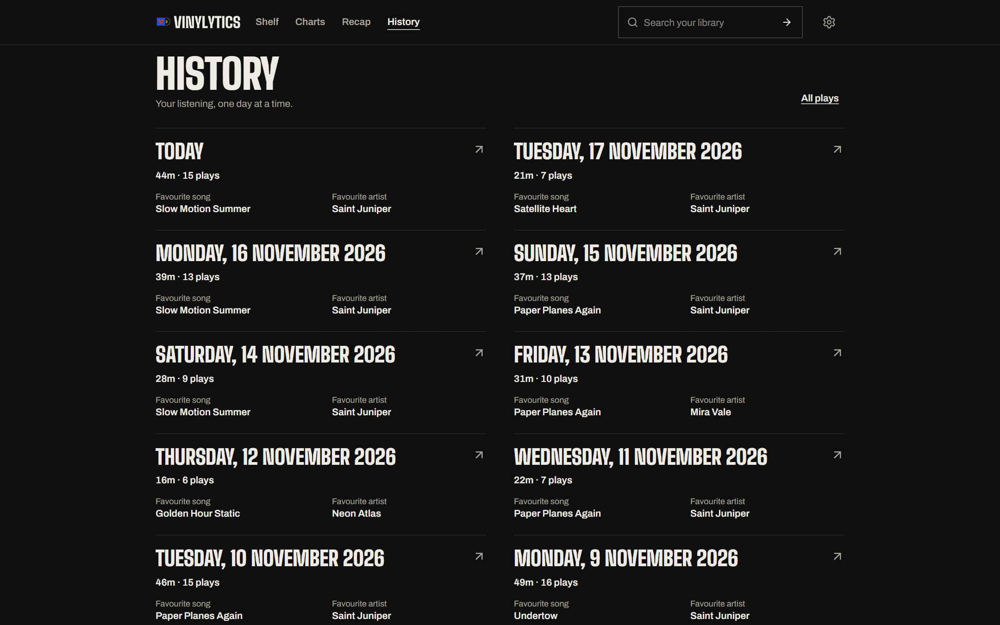
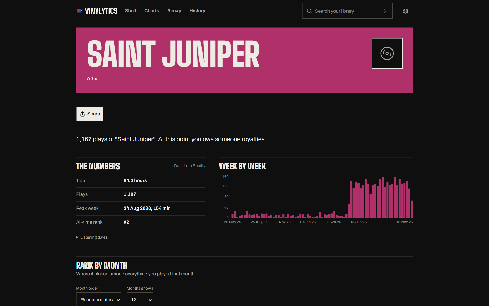
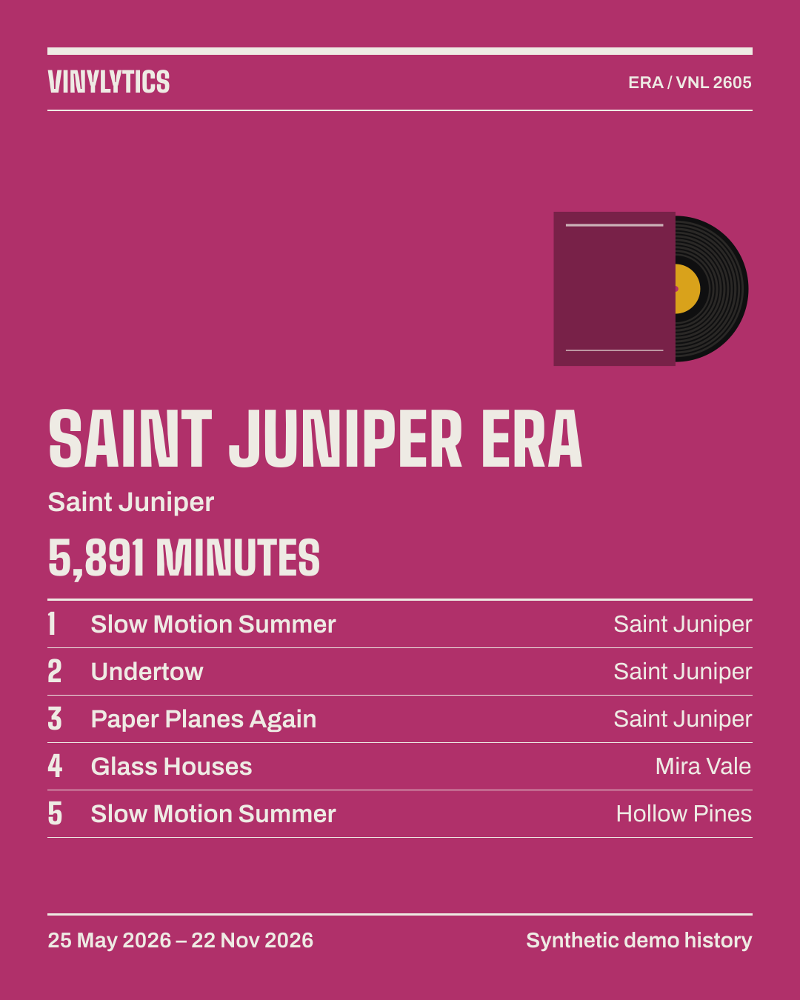
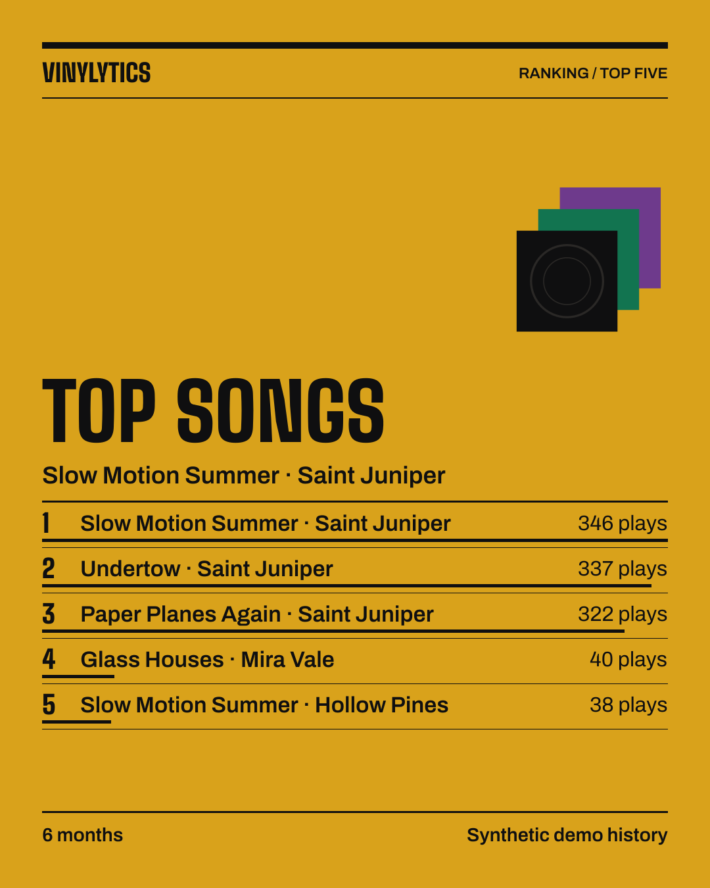
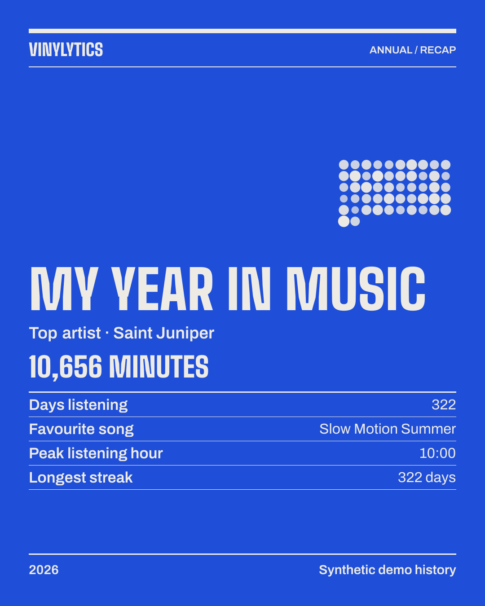
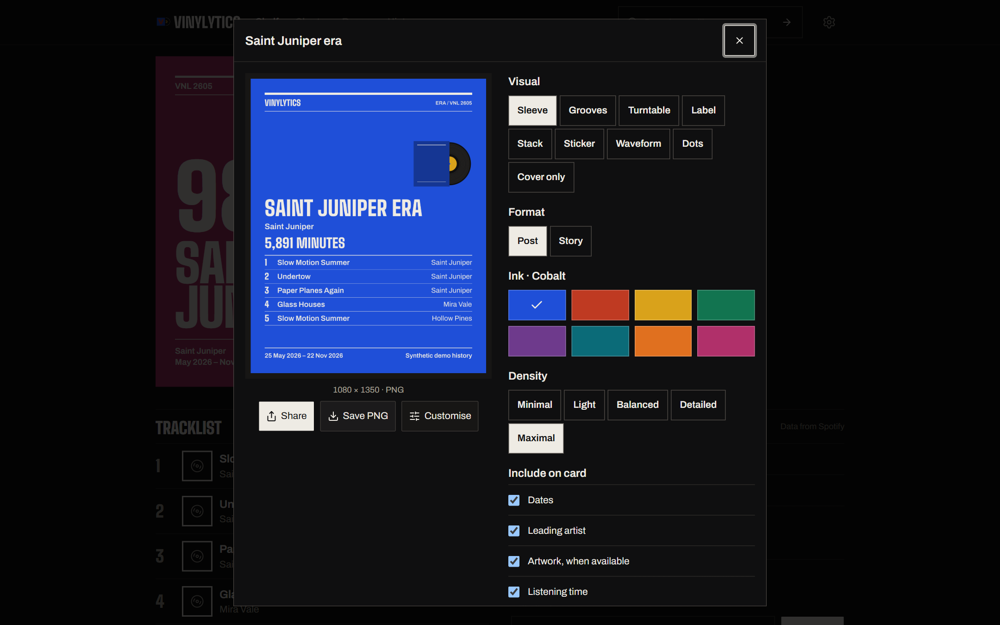
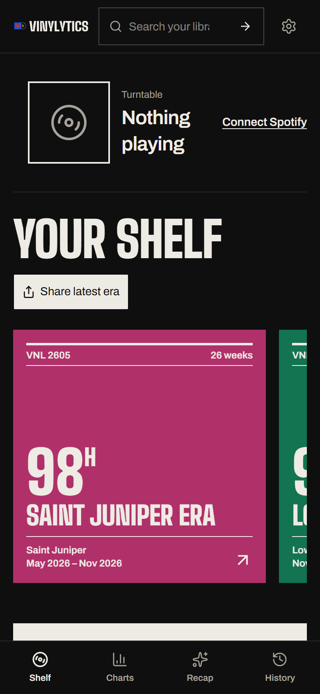
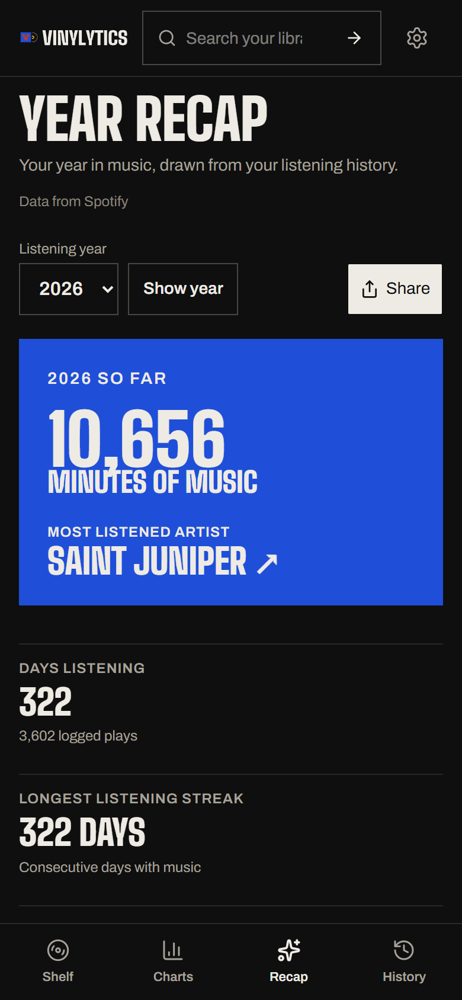
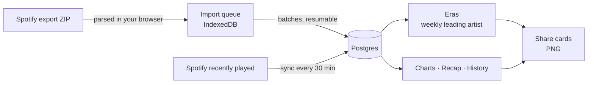

<p align="center">
  <picture>
    <source media="(prefers-color-scheme: dark)" srcset="docs/media/logo-dark.svg">
    
  </picture>
</p>

<h3 align="center">Your Spotify history, pressed as records.</h3>

<p align="center">
  Every phase you went through becomes a record sleeve. Every sleeve becomes a card you can send.<br>
  Self-hosted, single-owner, and your listening data stays yours.
</p>

<p align="center">
  <a href="#see-it-in-action">Tour</a> ·
  <a href="#features">Features</a> ·
  <a href="#choose-your-path">Get started</a> ·
  <a href="#set-up-a-live-copy">Self-host</a> ·
  <a href="#privacy">Privacy</a> ·
  <a href="#develop">Develop</a>
</p>

<p align="center">
  <a href="https://github.com/Tiebe-Vaes/vinylytics/actions/workflows/ci.yml"></a>
  <a href="LICENSE"></a>
  
  
  
</p>

## See it in action

<p align="center">
  <a href="docs/media/vinylytics-tour.mp4">
    
  </a>
  <br>
  <sub><a href="docs/media/vinylytics-tour.mp4">▶ Watch the 22-second tour with sound</a> · every screen uses the synthetic demo history, never a real person's listening</sub>
</p>

## Why Vinylytics

Spotify Wrapped shows up once a year and covers part of it. Your account's "top" lists only look back a few months. Vinylytics keeps everything you play, adds your full Extended Streaming History, and turns it into something worth looking at:

- **Eras, not just lists.** It finds the artist who led each week and presses every run of three weeks or more into a numbered record sleeve: *Saint Juniper era, May to November, 98 hours*.
- **Made to be shared.** One tap on Share gives a finished card. Customise it if you want: eight visuals, eight inks, five levels of detail, post or story size.
- **Your server, your data.** One owner per installation. The raw play log never leaves your database, and a public page only exists if you switch it on.

## Features

<table>
  <tr>
    <td width="50%" valign="top">
      <br>
      <b>Shelf</b> · Your eras as record sleeves, the turntable showing what's playing, and this week's listening with a roast line.
    </td>
    <td width="50%" valign="top">
      <br>
      <b>Eras</b> · Tracklist, liner notes, biggest day. Rename an era or merge it with the next one.
    </td>
  </tr>
  <tr>
    <td valign="top">
      <br>
      <b>Charts</b> · Top artists, songs and albums for 4 weeks, 6 months, a year, all time or your own dates. Rank by minutes or plays, grid or list.
    </td>
    <td valign="top">
      <br>
      <b>Recap</b> · A year in music: minutes, days listening, streaks, peak hour, repeat share, most-skipped and a daily calendar.
    </td>
  </tr>
  <tr>
    <td valign="top">
      <br>
      <b>History</b> · Every day with its total, favourite song and favourite artist. The raw play log is one tap away.
    </td>
    <td valign="top">
      <br>
      <b>Artist, song and album pages</b> · Totals, peak week, all-time rank and how it placed month by month. Search your library from any page.
    </td>
  </tr>
</table>

Also in the box: **resumable import** of Spotify's Extended Streaming History (it keeps going after a reload), **live sync** every 30 minutes, **artwork and genre** backfill, and an **opt-in public page** at `/u`.

### Share cards

<table>
  <tr>
    <td width="33%"></td>
    <td width="33%"></td>
    <td width="33%"></td>
  </tr>
</table>

Cards exist for eras, top charts, single artists, songs and albums, and the year recap. Each carries one visual drawn from its own data: a record sliding out of its sleeve, grooves cut from your weekly listening, a turntable, a record label, a stack of sleeves, a shop sticker with a listening barcode, a waveform or a dot calendar. They render as 1080 × 1350 posts or 1080 × 1920 stories. Where the browser supports it, Share opens the native share sheet. Otherwise you save a PNG.

<p align="center"></p>

### On your phone

<p align="center">
  
  &nbsp;&nbsp;
  
</p>

The same app at every size, with a tab bar on phones.

## Choose your path

**Do you want a recap once, or a copy that keeps updating?**

| You want | Path | Needs |
|---|---|---|
| To see your history and recap, maybe share a card | [Recap on your computer](#recap-on-your-computer) | Node.js and your Spotify export. No Spotify app, secrets or hosting. |
| New plays added automatically, reachable from your phone | [Set up a live copy](#set-up-a-live-copy) | A Spotify developer app (Premium) and Docker or Vercel with Neon. |

You can start with the recap and set up a live copy later.

## Recap on your computer

1. Request **Extended streaming history** in your Spotify account’s privacy settings. Spotify emails a ZIP, which can take up to 30 days.
2. Install [Node.js](https://nodejs.org) 22 or newer.
3. Download this repository (**Code → Download ZIP** on GitHub, then unzip it), open a terminal in that folder and run:

   ```sh
   npm ci
   npm run local
   ```

4. Open `http://127.0.0.1:3000`, choose **Import history** and select the ZIP. Your plays stay on this computer in `.data/pglite-mine`.

There is no sign-in, so the app only answers on this computer. Stop it with Ctrl+C and run `npm run local` again whenever you want to look back. To start over, stop the app and delete `.data/pglite-mine`.

## Set up a live copy

Choose **Docker** to run the app and database on your own machine, or **Vercel with Neon** to host them online. Both paths use the same Spotify app.

A live-sync installation connects to one owner’s Spotify account and database. Spotify requires the owner of a development-mode app to have Premium. [Spotify quota modes](https://developer.spotify.com/documentation/web-api/concepts/quota-modes)

### Create your Spotify app

1. Open the Spotify Developer Dashboard, sign in with the Premium account you want to use, and select **Create app**. Give it a name such as “My Vinylytics”, select **Web API**, and save. [Spotify Developer Dashboard](https://developer.spotify.com/dashboard)
2. Enter a callback address. For Docker on this computer, use `http://127.0.0.1:3000/api/auth/callback`. For a hosted copy, use its HTTPS address followed by `/api/auth/callback`. If Vercel has yet to assign the address, register the loopback callback and add the hosted callback after the first deployment. Spotify matches the full address, including the scheme, port, and path. [Spotify redirect rules](https://developer.spotify.com/documentation/web-api/concepts/redirect_uri)
3. In the app's **Settings**, copy **Client ID** and reveal **Client secret**. Keep the secret in your deployment settings or password manager.
4. Open your Spotify profile, select **Share → Copy link to profile**, and take the part after `/user/` and before any `?`. This is your owner ID. Enter it before your first sign-in to pin the installation to your account.

### Generate two secrets

Run the command twice and save the outputs separately. Use one for `AUTH_SECRET` and the other for `CRON_SECRET`.

**Windows PowerShell**

```powershell
$bytes = New-Object byte[] 32
$rng = [System.Security.Cryptography.RandomNumberGenerator]::Create()
$rng.GetBytes($bytes)
$rng.Dispose()
[Convert]::ToBase64String($bytes)
```

**macOS or Linux**

```sh
openssl rand -base64 32
```

### Option A · Docker

1. Install and start Docker Desktop or Docker Engine with the Compose plugin. Clone or download this repository and open a terminal in the folder that contains `docker-compose.yml`.
2. Copy the example configuration. On Windows run `Copy-Item .env.example .env` in PowerShell. On macOS or Linux run `cp .env.example .env`.
3. Open the new `.env` in a text editor and fill in the Spotify values and both generated secrets from the [table below](#environment-variables). Leave `DATABASE_URL` blank so Compose can use its own Postgres service.
4. Run `docker compose up -d --build`. Then run `docker compose ps` and look for the running app and healthy database. If the app restarts repeatedly, run `docker compose logs --tail=50 app`.
5. Open `http://127.0.0.1:3000`, sign in with Spotify, and choose **Settings → Sync now**. The connection status and last-sync time should update. The Compose cron service makes subsequent sync attempts every 30 minutes.

For access from another machine, put the app behind an HTTPS reverse proxy and register the exact HTTPS callback in Spotify and `.env`. After changing environment values, run `docker compose up -d`. Back up the database before upgrading, then pull the new source and run `docker compose up -d --build`.

### Option B · Vercel with Neon

1. Fork this repository on GitHub. In Vercel, select **Add New → Project** and import your fork.
2. Create a Neon Postgres database. Connect it through the Vercel integration or copy the connection string from Neon's **Connect** dialog into the Vercel project's **Settings → Environment Variables** as `DATABASE_URL`.
3. Add the Spotify credentials, owner ID, two generated secrets, and callback URI from the [table below](#environment-variables) to the **Production** environment. Use the registered loopback callback for the first build if the hosted address is pending. Give Preview its own Neon branch or disable automatic preview deployments. The build command applies database migrations.
4. Deploy. Copy the Production HTTPS address from the deployment, add `/api/auth/callback`, and register that full URI in Spotify. Set the same URI as the Production `SPOTIFY_REDIRECT_URI` in Vercel, then redeploy.
5. In your GitHub fork, open **Settings → Secrets and variables → Actions**. Add `APP_URL` with the Production base address without a trailing slash, and `CRON_SECRET` with the exact value from Vercel.
6. Sign in on the Production address. Go to **Actions → Spotify sync → Run workflow** and verify the run succeeds and the app shows a last-sync time. Enable Actions on your fork if prompted. [Run a GitHub workflow](https://docs.github.com/en/actions/how-tos/manage-workflow-runs/manually-run-a-workflow)

When changing a Vercel environment value, redeploy the affected environment. When rotating `CRON_SECRET`, update GitHub Actions too. Keep a Neon backup or restore point before updating from upstream.

### Environment variables

Put these in the copy of `.env` next to `docker-compose.yml`, or in Vercel's Production environment.

| Name | Where to get it |
|---|---|
| `SPOTIFY_CLIENT_ID` | Spotify app **Settings → Client ID**. |
| `SPOTIFY_CLIENT_SECRET` | Spotify app **Settings → Client secret**. Keep private. |
| `SPOTIFY_REDIRECT_URI` | The exact registered callback URI, ending in `/api/auth/callback`. |
| `OWNER_SPOTIFY_ID` | Your Spotify profile link. Set before sign-in. |
| `AUTH_SECRET` | First generated secret. Signs sessions. Rotating it signs everyone out. |
| `CRON_SECRET` | Second generated secret. Compose passes it to the app and cron service from the same file. On Vercel, save the same value in GitHub Actions. |
| `DATABASE_URL` | Compose supplies this automatically. Vercel uses Neon’s Postgres connection string. Keep it private. |
| `TIMEZONE` | Optional IANA time zone such as `Europe/Brussels`. Defaults to `UTC`. |
| `LASTFM_API_KEY` | Optional key from your Last.fm API account for genre tags. Keep private. |

### Import your listening history

Request **Extended streaming history** from your Spotify account’s privacy settings. When the ZIP arrives, open Vinylytics and go to **Settings → Import history**. Select the ZIP (or its `Streaming_History_Audio_*.json` files). The app parses it in your browser and uploads only the fields needed for listening statistics, never your IP address, country or device.

- **Keep the tab open while it says Preparing.** If you close or reload it during that step, choose the files again.
- **Once it says Saving, you can browse other pages.** Progress stays visible in the corner. If you reload or close the tab, the upload resumes from the last saved batch when you open Vinylytics again in the same browser.
- **Pause, Resume and Cancel** sit next to the progress bar. Cancelling keeps the plays already saved.
- **One import at a time.** A second tab shows that the import runs elsewhere and takes over if the first tab closes.
- **Importing the same export again is safe.** Plays already stored are skipped.

When the upload finishes, artwork and genres keep filling in in the background.

### Troubleshooting

| What you see | What to check |
|---|---|
| Spotify rejects the callback | Compare the complete URI in Spotify and your environment. Open the app at the same origin. On local Docker, use the numeric loopback address. |
| Wrong account or failed sign-in | Compare the profile ID with `OWNER_SPOTIFY_ID`, confirm the app owner's Premium status, and sign in with that same account. |
| No recent plays | Play a track, choose **Sync now**, and check the Spotify connection status. On Docker, inspect `docker compose logs --tail=30 cron`. On GitHub, check the **Spotify sync** run and both Actions secrets. |
| Build or startup fails | Check the app logs. On Vercel, confirm the database URL is set for the environment being built. On Docker, check that the database service is healthy and that port 3000 is free. |
| Covers are missing | Artwork fills in during sync, a limited batch per run. Items Spotify has no artwork for keep a placeholder and are checked again every six hours. |

### Ask an AI coding agent to guide setup

Copy this into an agent that has access to your repository:

> Help me set up Vinylytics in this checkout. Inspect README.md, .env.example, package.json, Docker and Vercel configuration, and the sync workflow. Identify my OS and installed tools, then ask whether I want Docker or Vercel with Neon if you cannot infer it. Give me one step at a time and tell me what I should see before continuing. Use current official docs if dashboard steps have changed. You can prepare local config with placeholders and verify commands and status. Guide me through the Spotify, Vercel, Neon and GitHub dashboard actions I need to perform myself. Let me enter all credentials directly in the local file or dashboard. Keep secrets, tokens, database connection strings, and my listening history out of chat, logs and Git. Verify sign-in, sync and import with me, and report anything still pending.

## Privacy

- **One owner.** Only one Spotify account can sign in: the one in `OWNER_SPOTIFY_ID`, or else the first account that signs in. Everyone runs their own copy with their own database.
- **Your export is cleaned on your device.** The browser reads the ZIP and uploads only what statistics need: when you played, for how long, the track, artist and album, and how it started, ended, skipped or shuffled. IP address, country and device never leave your machine.
- **Private by default.** The public page at `/u` is off until you switch it on, and you choose which sections it shows. The play log is never public.
- **No third-party analytics.** The app talks only to Spotify, Spotify's image CDN for covers, and Last.fm if you add a key.

## How it works



- **Eras.** For each week the artist with the most minutes leads. Three or more weeks with the same leader form an era. Quiet weeks under 30 minutes don't break a run, and four silent weeks in a row end one. Only your renames and merges are stored; the eras themselves are recalculated from your plays.
- **No double counting.** A synced play and the same play in your export, within a minute of each other, merge into one. Import batches carry a server cursor, so a retried batch never adds plays twice.
- **Built with** Next.js 16, React 19, TypeScript, Tailwind CSS 4, Base UI, Recharts, Drizzle ORM on Postgres (PGlite for local mode and tests), `next/og` and sharp for cards, fflate for streaming the export, and Vitest.

## Develop

```sh
npm ci
npm run dev:local
```

Local demo mode uses a separate database with synthetic plays. Use `npm run typecheck`, `npm run lint`, `npm test`, and `npm run build` to check a change.

| Command | What it does |
|---|---|
| `npm run dev:local` | Dev server with a synthetic demo history, no sign-in. Add `-- --reset` to start fresh or `-- 3100` for another port. |
| `npm run local` | Your own history on this computer: separate database, no seed, no sign-in. |
| `npm run typecheck` | Generates Next's route types, then runs TypeScript. |
| `npm test` | Vitest, with an in-memory Postgres for database tests. |

Issues and pull requests are welcome. CI runs typecheck, lint, tests and a production build on every push.

## Credits and licence

Data from Spotify. Genre tags from Last.fm. Type by Big Shoulders and Archivo. Released under the [MIT licence](LICENSE).

<sub>Vinylytics is not affiliated with or endorsed by Spotify.</sub>
