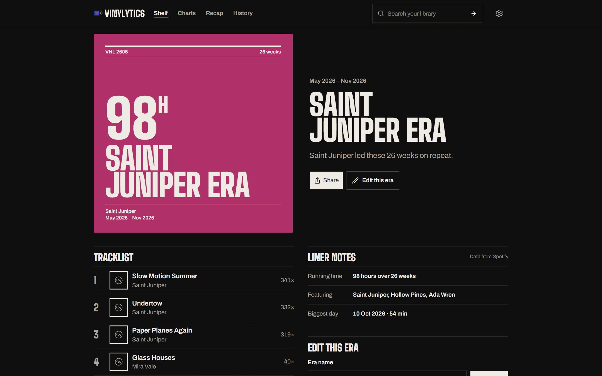
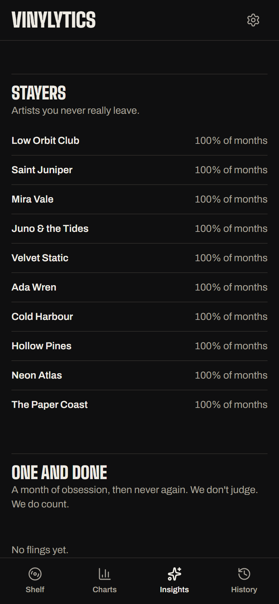

# Vinylytics

**Your Spotify history, pressed as records.**

Vinylytics cuts your listening history into eras and presses each one as a record: one spot colour, the era's top songs as the tracklist, the numbers as liner notes. Your whole history becomes a shelf you can flip through. It also does everything you'd open a stats app for, free, on your own server.

<p>
  
  
  
  
</p>

<sub>Screenshots show the built-in demo data: a synthetic listening history, not a real person's.</sub>

[](https://vercel.com/new/clone?repository-url=https%3A%2F%2Fgithub.com%2FTiebe-Vaes%2Fvinylytics&env=SPOTIFY_CLIENT_ID,SPOTIFY_CLIENT_SECRET,SPOTIFY_REDIRECT_URI,AUTH_SECRET,CRON_SECRET,OWNER_SPOTIFY_ID&envDescription=Keys%20from%20your%20own%20Spotify%20app%20and%20two%20random%20secrets&envLink=https%3A%2F%2Fgithub.com%2FTiebe-Vaes%2Fvinylytics%23environment-variables&project-name=vinylytics&repository-name=vinylytics&stores=%5B%7B%22type%22%3A%22integration%22%2C%22integrationSlug%22%3A%22neon%22%2C%22productSlug%22%3A%22neon%22%7D%5D)

## What it does

**Your discography**
- Eras, found automatically from who you listened to most, week by week. Rename them, merge them.
- Each era as a sleeve: hours, weeks, lead artists, and a tracklist of its 12 most-played songs.
- Share cards: any era, or your top artists and tracks, as a PNG sized for a post or a story.

**Everything a stats app does, free**
- Top artists, tracks and albums, by time or by plays, over 4 weeks, 6 months, a year, all time or any dates you pick.
- A page per artist, track and album: first play, total hours, peak week, rank each month.
- Listening clock, minutes per month, a calendar of every day, genres from Last.fm, skip rates.
- The full play-by-play history.
- Full history import from Spotify's extended streaming history, merged with the live sync without counting a play twice.

**The stats nobody else shows**
- **B-sides:** songs you played to death, then dropped.
- **Reissues:** songs you came back to after half a year.
- **Stayers and one-and-done:** the artists you keep, and the month-long flings.
- **Album completion:** which albums you played front to back.
- **Streaks:** most days in a row with one artist.
- **On this day:** what you were playing a year ago.

All of it is written in a voice that teases you about your habits. The numbers stay exact.

**Opt-in public page.** Switch it on to share your shelf and top lists at `/u`. It's off until you turn it on, and your play history is never shown.

## Why self-hosted

Spotify development-mode apps are limited to [5 allowlisted users](https://developer.spotify.com/documentation/web-api/concepts/quota-modes), so a shared site would fill up fast. Instead, everyone runs their own copy, with their own Spotify app and their own database. Your history stays yours, and nothing is behind a paywall.

## Set it up

About 15 minutes. You need a Spotify account with Premium, plus either Vercel (free) or a machine with Docker.

### 1. Create a Spotify app

1. Go to [developer.spotify.com/dashboard](https://developer.spotify.com/dashboard) and create an app.
2. Add a redirect URI:
   - Deployed: `https://<your-app>/api/auth/callback`
   - Local: `http://127.0.0.1:3000/api/auth/callback`. Spotify rejects `localhost`.
3. Tick **Web API**, save, and copy the client ID and client secret.

**Never add other people to your Spotify app's user list.** In development mode only listed accounts can sign in, and you are listed automatically, so that list is what keeps your copy yours.

**Pin yourself as the owner.** Set `OWNER_SPOTIFY_ID` to your Spotify user id before the first deploy. Without it, the first account to sign in claims the copy. To find your id:
1. Open your profile in the Spotify app or at open.spotify.com.
2. Choose **Share → Copy link to profile**.
3. The id is the part after `/user/` and before any `?`.

### 2a. Deploy on Vercel with Neon

1. Click **Deploy with Vercel** above. It forks the repo, adds a Neon database and asks for the environment variables in the table below.
2. Deploy once to learn your app's address, for example `https://vinylytics-you.vercel.app`.
3. Set `SPOTIFY_REDIRECT_URI` to `<that address>/api/auth/callback`, add the same URI to your Spotify app, and redeploy.
4. In your fork, go to **Settings → Secrets and variables → Actions** and add two secrets:
   - `APP_URL`: your app's address.
   - `CRON_SECRET`: the same value as in Vercel.

   The `Spotify sync` workflow then pulls new plays every 30 minutes. GitHub pauses scheduled workflows after 60 days without commits. Re-enable it in the Actions tab if that happens.
5. Open the app and sign in with Spotify.

The repository's `vercel.json` sets the build command to `npm run vercel-build`, which applies the database migrations before building. Preview deployments run it too: give previews a separate Neon branch/database, or disable previews until one is configured. Do not point preview builds at your production database.

### 2b. Or run it with Docker

```bash
cp .env.example .env
```

Fill in `.env`, leaving `DATABASE_URL` empty because compose sets it. Then:

```bash
docker compose up -d --build
```

This starts the app on port 3000 with Postgres 17 and a small job that syncs every 30 minutes. Open it at the host in your `SPOTIFY_REDIRECT_URI`, for example `http://127.0.0.1:3000`.

### 3. Import your full history

The live sync only sees plays from the moment you connect. For everything before that:

1. Go to spotify.com → **Account → Privacy** and request **Extended streaming history**. It can take up to 30 days to arrive.
2. In Vinylytics, open **Settings → Import history** and drop the zip.

The file is read in your browser. Only the plays are uploaded, never your IP address, country or device.

### Environment variables

| Variable | Required | What it is |
|---|---|---|
| `DATABASE_URL` | yes | Postgres connection string (Postgres 15 or newer) |
| `SPOTIFY_CLIENT_ID` | yes | From your Spotify app |
| `SPOTIFY_CLIENT_SECRET` | yes | From your Spotify app |
| `SPOTIFY_REDIRECT_URI` | yes | Must match the app's redirect URI exactly |
| `AUTH_SECRET` | yes | Signs your session. Generate with `openssl rand -base64 32` |
| `CRON_SECRET` | yes | Bearer token the sync job sends. Generate the same way |
| `OWNER_SPOTIFY_ID` | recommended | Your Spotify user id. When set, only this account can ever sign in |
| `TIMEZONE` | no | IANA name for day and hour stats, for example `Europe/Brussels`. Default `UTC` |
| `LASTFM_API_KEY` | no | Adds genre tags from Last.fm |

### Signing out

Sign out clears the session cookie in your browser. Sessions are signed, not stored, so a copied cookie stays valid for up to 30 days. To end every session at once, change `AUTH_SECRET` and redeploy.

## How it's built

Next.js 16 (App Router, server components and server actions), React 19, Drizzle on Postgres, Tailwind v4, `next/og` for the share cards. Tested with Vitest against an in-process Postgres (PGlite) running the real migrations, and checked in CI on every push.

**Eras.** Each week is labelled with the artist you played most; weeks under 30 minutes are quiet. Four quiet weeks in a row end an era. Runs shorter than three active weeks are folded into their heavier neighbour until every era is at least three weeks long. Your renames and merges are stored apart from the eras and re-applied every time, so they survive new data.

**One play, counted once.** The live sync and the export record the same play a few seconds apart. Imports fold an api play into its export twin, which carries the real duration and skip data.

**Spotify's rules.** Covers are shown unaltered and small, with attribution, and are linked from Spotify's servers, never stored. The colour of each era comes from its lead cover's dominant hue, snapped to one of eight inks that all pass WCAG AA with their type.

## Develop

```bash
npm install
npm run dev:local
```

This runs on a local in-process database with about 6,000 synthetic plays and no sign-in. Nothing touches a real database. Add `-- --reset` to wipe it, or `-- --empty` for a copy with no plays at all.

Checks: `npx tsc --noEmit`, `npx eslint src`, `npx vitest run`, `npx next build`.

## Credits

Data from Spotify. Genre tags from Last.fm. Type: Big Shoulders and Archivo.

## Licence

MIT
