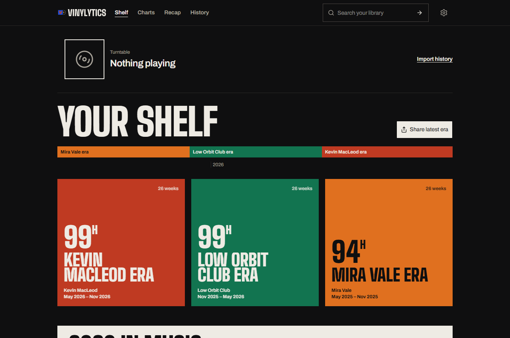
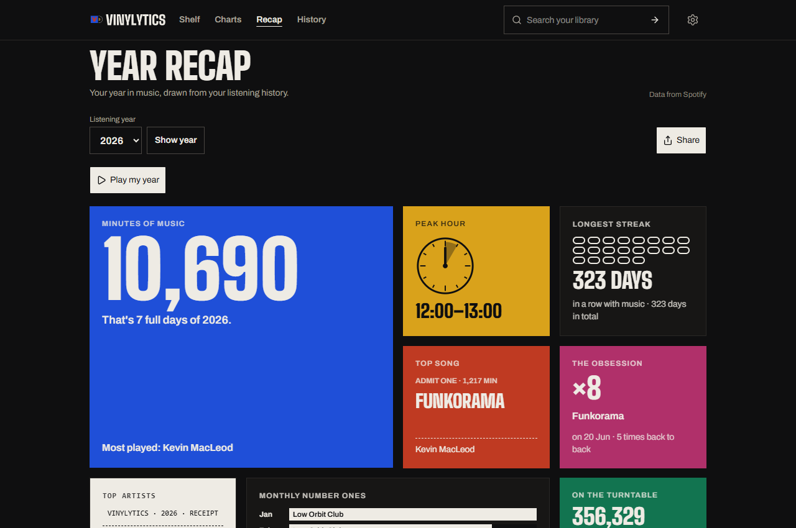
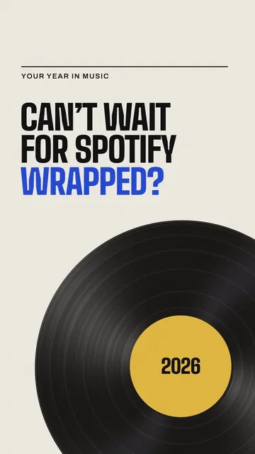

<p align="center">
  <picture>
    <source media="(prefers-color-scheme: dark)" srcset="docs/media/logo-dark.svg">
    
  </picture>
</p>

# Your Spotify history, pressed as records

Which artist owned your summer? Which song did you play six times after midnight? Vinylytics turns your Spotify listening history into a shelf of record sleeves. Open a sleeve to revisit an era, play a recap of your year so far, or send a friend the card that explains the obsession.

**[Open Vinylytics in your browser](https://vinylytics-fm.vercel.app/get-started)** · [Watch *December Can Wait* (15s)](https://vinylytics-fm.vercel.app/media/ad.mp4) · [Self-host with live sync](#set-up-a-live-copy)



## Get started with your Spotify export

1. Request **Extended streaming history** in your [Spotify privacy settings](https://www.spotify.com/account/privacy/) and confirm the request by email.
2. When Spotify sends your ZIP, drop it onto the [Vinylytics import page](https://vinylytics-fm.vercel.app/get-started). Leave the ZIP intact. Your browser reads it and stores the plays on your device.
3. Open **Shelf** for your eras, or **Recap → Play my year** for the highlights. Open an era and select **Share** to export its sleeve as a PNG.

You can import a newer export later. Vinylytics skips plays it already has. Use **Settings → Save backup** before clearing browser data or moving devices, then **Restore backup** in the destination browser.

## See it in action

| Explore | What you can find |
| --- | --- |
| **Shelf and eras** | An artist who leads your listening for at least three weeks can earn a sleeve. Open it for the tracklist, first song, peak week and closing track. Rename the era or merge adjacent eras. |
| **Charts** | Rank artists, tracks or albums over a preset period or your own dates. Switch between play count and listening time to see how the rankings change. |
| **Year recap** | Play a sequence of highlights or explore the full year on one page, from your longest streak to the artists who topped each month. |
| **History and search** | Jump to a date, inspect the plays behind a daily total, or follow a song, artist or album through your library. |
| **Share cards** | Choose an ink colour, visual and which details to print. Save a 1080 × 1350 post or a 1080 × 1920 story. |

| The year recap | The share-card editor |
| --- | --- |
| [](docs/screenshots/recap.png) | [](docs/screenshots/composer.png) |

<details>
<summary>Watch the 15-second release film · December Can Wait</summary>

<p align="center">
  <a href="docs/media/vinylytics-ad.mp4"></a><br>
  <a href="docs/media/vinylytics-ad.mp4">Open the film with sound</a>
</p>

</details>

The film and screenshots use synthetic listening histories.

## Choose where your history lives

| Mode | Storage | How new plays arrive |
| --- | --- | --- |
| [Browser](https://vinylytics-fm.vercel.app/get-started) | PGlite in this browser profile, on this device | Import a Spotify export whenever you like. No sign-in or installation. |
| [Local on your computer](#run-locally) | A database folder on your computer | Import exports through the local app. No Spotify developer credentials required. |
| [Self-hosted](#set-up-a-live-copy) | PostgreSQL on your infrastructure | Import past plays, then connect Spotify to sync recent plays on a schedule. |

## Run locally

Install Node.js 22 (latest 22.x), download or clone this repository, and run the following from its root:

```sh
npm ci
npm run local
```

Open `http://127.0.0.1:3000`, select **Import history**, and choose your ZIP. This mode listens on the loopback address and keeps your history in `.data/pglite-mine` between runs. To explore with invented data instead, run `npm run dev:local`. The demo uses a separate database.

## Set up a live copy

A self-hosted installation serves one Spotify account. Import your export to backfill earlier years. The sync job then requests recently played tracks every 30 minutes.

### Configure Spotify and the environment

1. Create a Web API app in the [Spotify Developer Dashboard](https://developer.spotify.com/dashboard). The owner of a development-mode app needs Spotify Premium. [Spotify quota modes](https://developer.spotify.com/documentation/web-api/concepts/quota-modes)
2. Register the exact callback URI. For local Docker use `http://127.0.0.1:3000/api/auth/callback`. For a hosted installation use your HTTPS origin followed by `/api/auth/callback`. [Spotify redirect URI requirements](https://developer.spotify.com/documentation/web-api/concepts/redirect_uri)
3. Set the values below in your deployment environment. For Docker, copy [.env.example](.env.example) to `.env` first. Generate independent values for the two secrets by running `node -p "require('node:crypto').randomBytes(32).toString('hex')"` twice, or use a password manager.

| Variable | Value |
| --- | --- |
| `SPOTIFY_CLIENT_ID`, `SPOTIFY_CLIENT_SECRET` | Credentials from your Spotify app. |
| `SPOTIFY_REDIRECT_URI` | The callback registered in step 2. |
| `OWNER_SPOTIFY_ID` | Your Spotify user ID, found after `/user/` in your profile link. Set it before signing in to reserve the installation for your account. Otherwise the first account to sign in becomes the owner. |
| `AUTH_SECRET`, `CRON_SECRET` | Separate secrets for signing sessions and authorising sync requests. |
| `DATABASE_URL` | PostgreSQL connection string on Vercel. Compose supplies its own value. |
| `TIMEZONE` | Optional IANA time zone for day and hour statistics, for example `Europe/Brussels`. Defaults to UTC. |
| `LASTFM_API_KEY` | Optional Last.fm key for genre tags. |

### Docker Compose

From the folder containing [docker-compose.yml](docker-compose.yml), run:

```sh
docker compose up -d --build
docker compose ps
```

Open `http://127.0.0.1:3000`, sign in with Spotify and choose **Settings → Sync now**. Check the last-sync time. Compose runs the app, PostgreSQL and the scheduled sync worker. For remote access, use an HTTPS reverse proxy and register its callback address. Back up the database volume before upgrading.

### Vercel and Neon

1. Fork this repository and import the fork as a Vercel project. Create a Neon PostgreSQL database and add its connection string and the variables above to Vercel’s **Production** environment. The configured build applies database migrations. Use a separate database for previews or disable preview deployments.
2. Deploy, register the final production callback in Spotify and confirm that `SPOTIFY_REDIRECT_URI` matches it. Redeploy after changing environment values.
3. In your fork, enable GitHub Actions and add two **Actions secrets**: `APP_URL` (your production origin without a trailing slash) and `CRON_SECRET` (the same value used by Vercel).
4. Sign in on the production site. Run **Actions → Spotify sync → Run workflow**, then check the last-sync time in Settings. The [sync workflow](.github/workflows/sync.yml) also runs on a 30-minute schedule.

### Import and troubleshoot

On a self-hosted copy, open **Settings → Import history** and choose the ZIP or its `Streaming_History_Audio_*.json` files. Keep the tab open during **Preparing**. Once **Saving** begins, the import can resume in the same browser after a reload. Cancelling keeps the plays already saved.

| Symptom | First check |
| --- | --- |
| Spotify rejects sign-in | Compare the full callback URI and the owner ID. For local Docker, open the app at `127.0.0.1`. |
| Recent plays are missing | Play a track and select **Sync now**. For scheduled sync, check `docker compose logs --tail=30 cron` or the GitHub Actions run and its secrets. |
| The app fails to start | Run `docker compose logs --tail=50 app`, or check Vercel build logs and the database connection for that environment. |
| Browser history disappears | Check the device and browser profile. Clearing site data removes local plays. Restore a saved backup in Settings. |

## Privacy

The hosted browser edition processes your export and renders cards on your device. A self-hosted copy sends the listening fields needed for statistics to your own server. The import discards device, country and IP-address fields.

On a self-hosted copy, the public profile at `/u` is off by default. You choose which summaries to publish. Your play-by-play history stays private. Optional integrations include Last.fm genre tags and Open-Meteo weather comparisons when you configure a city.

## Development

Vinylytics uses Next.js, React, TypeScript and Drizzle. The browser build runs queries against PGlite and renders share cards locally. The self-hosted build uses PostgreSQL. The [showcase site](https://vinylytics-fm.vercel.app/) builds and serves the browser edition under `/app`.

| Command | Purpose |
| --- | --- |
| `npm run dev:local` | Start the development server with seeded demo listening history. |
| `npm run dev:browser` | Develop against the browser-only runtime. |
| `npm run build:browser` | Generate the static browser app in `out-browser/`. |
| `npm run typecheck` · `npm run lint` · `npm test` | Check route types, lint the code and run the test suite. |
| `npm run build` | Build the server edition for production. |

[Report an issue](https://github.com/Tiebe-Vaes/vinylytics/issues) · [CI workflow](.github/workflows/ci.yml) · [MIT license](LICENSE)

Created by Tiebe Vaes. Typefaces are Archivo and Big Shoulders. *December Can Wait* uses an original instrumental breakbeat. Vinylytics is an independent project, unaffiliated with Spotify.
